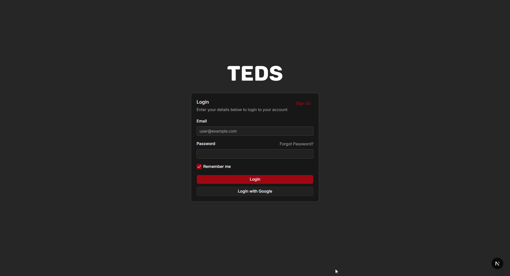
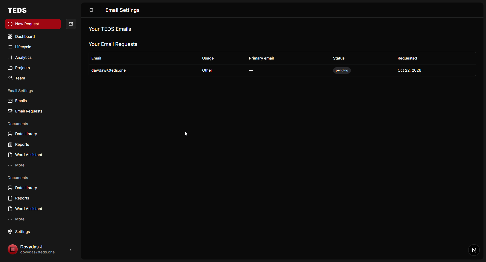

# TEDS Accounts

Live Site: [accounts.teds.one](https://accounts.teds.one) (WIP)

TEDS Accounts is a NextJS app that uses Better Auth for authentication.
It aims to simplify management of user emails, which in my use-case, is for teds.one emails and accounts, as well as allow self-service. I also plan to use it as a SAML / SSO IDP for other apps.

Current Features:
- Google Sign in
- Email + Password login + signup
- Submit Email Requests

Planned Features:
- Email Management (with PurelyMail API)
- Google Workspace + Microsoft Entra ID account provisioning
- Shared mailboxes (not likely)
- Admin Panel
- Extra accounts to link (such as discord with possibly use with a discord bot)
- Account Security / Management (for Better Auth e.g. change password, 2fa, passkeys)

## Screenshots





## Info

This app is hosted using Cloudflare Workers, D1 and KV.
It is built using:
- [`better-auth-cloudflare`](https://github.com/zpg6/better-auth-cloudflare)
- Bun (nodejs compatible)
- NextJS
- Better Auth
- shadcn/ui

## Getting Started

First, run the development server:

```bash
npm run dev
# or
yarn dev
# or
pnpm dev
# or
bun dev
```

Open [http://localhost:3000](http://localhost:3000) in a browser

## Authentication Scripts

Our package provides several scripts to help manage authentication:

- `bun auth:generate`: Generates the Drizzle schema for Better Auth based on the configuration in `src/auth/index.ts`. The output is saved to `src/db/auth.schema.ts`.
- `bun auth:format`: Formats the generated `auth.schema.ts` file using Prettier.
- `bun auth:update`: A convenience script that runs both `auth:generate` and `auth:format` in sequence.

## Database Management

- `bun db:generate`: Generates SQL migration files based on changes in the Drizzle schema (defined in `src/db/schema.ts` and the generated `src/db/auth.schema.ts`).
- `bun db:migrate:dev`: Applies pending migrations to the local D1 database.
- `bun db:migrate:prod`: Applies pending migrations to the remote/production D1 database.
- `bun db:studio:dev`: Starts Drizzle Studio, a local GUI for browsing the local D1 database.
- `bun db:studio:prod`: Starts Drizzle Studio for the remote/production D1 database.

## Deployment Scripts

Deploy to Cloudflare:

- `bun build:cf`: Builds the application specifically for Cloudflare Workers using OpenNext.
- `bun deploy`: Builds the application for Cloudflare and deploys it.
- `bun preview`: Builds the application for Cloudflare and allows you to preview it locally before deploying.

## Additional Scripts

- `bun build`: Creates an optimized production build.
- `bun clean`: Removes build artifacts, cached files, and `node_modules`.
- `bun clean-deploy`: Cleans the project, reinstalls dependencies, and then deploys.
- `bun format`: Formats all project files using Prettier.
- `bun lint`: Lints the project using Next.js's built-in ESLint configuration.

### Environment Variables

For production deployment, set the following via `wrangler.toml` `[vars]` or Cloudflare secrets:

- `BETTER_AUTH_URL` — The worker's primary base URL (e.g., `https://accounts.teds.one`). Set as a `[vars]` entry.
- `BETTER_AUTH_TRUSTED_ORIGINS` — Comma-separated list of additional trusted origins (e.g., `https://test.workers.dev`). Set as a `[vars]` entry.
- `BETTER_AUTH_SECRET` — A random 32+ character secret. Set via `wrangler secret put BETTER_AUTH_SECRET`.
  

## Credits / Disclosure

The getting started / dev part of the README was taken from [`better-auth-cloudflare`](https://github.com/zpg6/better-auth-cloudflare).

[Purelymail](https://purelymail.com/) - The email hosting I use and will use the API to manage accounts. Had to place this here because the email service is great, especially for the price.

Some AI has been used, such as code completion, help with debugging as well as guidence and some aid with parts of the UI. The main / essential parts written without AI. All AI generated code has been read through, edited and possibly rewritten. Also, I like the look of (shadcn/ui)[https://ui.shadcn.com/] - it's not just something AI decided to use.
  